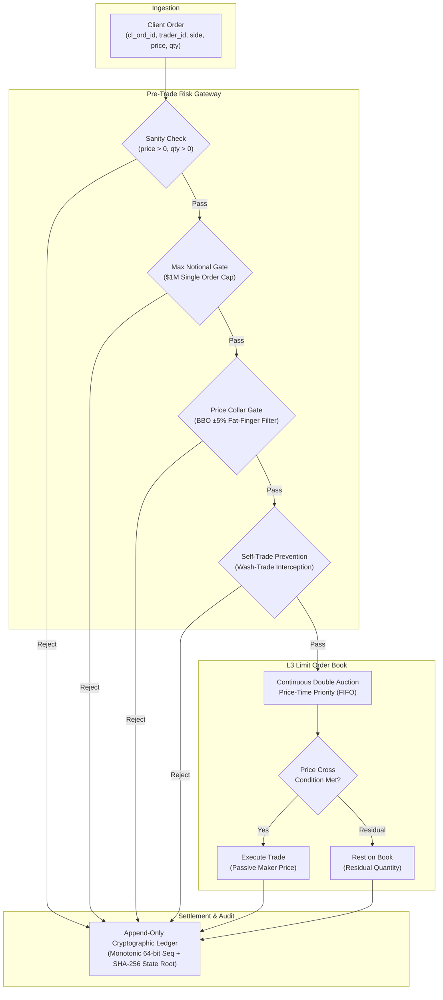

# High-Throughput Order Matching & Pre-Trade Risk Engine

[]()
[-blue.svg)]()
[]()
[]()

A high-performance limit order book (LOB) matching engine and real-time pre-trade risk gateway featuring **L3 price-time priority (FIFO)**, continuous double auction matching, **sub-millisecond execution**, **fat-finger price collars**, **self-trade prevention (STP)**, and an **append-only cryptographic audit ledger**.

Engineered specifically as demonstrable systems proof for quantitative trading platforms, market makers, and licensed digital asset exchanges in **Hong Kong** and **Tokyo** (*Flow Traders, HashKey Group, Jane Street HK, Rakuten FinTech, Sony Block Solutions / Soneium, and SBI / B2C2 Japan*).

---

## Architecture Overview



---

## Core Capabilities

1. **L3 Limit Order Book:**
   - Strict continuous double auction adhering to price-time priority (FIFO per price tick).
   - Fast $O(1)$ BBO resolution and $O(1)$ order cancellation indexing.
   - L3 depth aggregation and order book snapshots.

2. **Pre-Trade Risk Gateway:**
   - **Price Collar Protection:** Rejects fat-finger aggressive limit orders deviating by more than 5% from the Best Bid/Offer (BBO).
   - **Self-Trade Prevention (STP):** Intercepts and halts internal wash trades between identical trader accounts.
   - **Max Notional Filter:** Rejects orders exceeding single-order capitalization thresholds ($1,000,000 / ¥150,000,000 cap).

3. **Advanced Order Types & Lifecycle:**
   - **Limit Orders (`LIMIT`):** Crosses matching passive liquidity; rests remainder on book.
   - **Market Orders (`MARKET`):** Aggressive liquidity taker that sweeps opposing price levels down the book.
   - **Immediate-or-Cancel (`IOC`):** Fills available resting shares and cancels unfilled residual without resting.
   - **Post-Only (`POST_ONLY`):** Maker-or-cancel; rejects immediately if the order would cross resting orders.
   - **Atomic Cancel/Replace:** Atomically cancels an active resting order and submits a replacement at a new price level.

4. **Cryptographic Audit Ledger & Replay:**
   - Append-only event journal capturing order acceptances, cancellations, rejections, and trade fills.
   - Rolling SHA-256 state root ensuring tamper-evident state verification and 100% deterministic replay.

---

## Quickstart

### Installation
```bash
git clone https://github.com/elura172/order-matching-engine.git
cd order-matching-engine
uv sync
```

### Running the Test Suite
```bash
uv run pytest -v
```

### Running the Interactive Demonstration
```bash
uv run python demo.py
```

---

## Automated Institutional Evaluation Suite (10 Scenarios)

The engine features a built-in automated institutional trading benchmark covering 10 strict production scenarios:

| # | Scenario ID | Description | Specification & Metric |
|---|---|---|---|
| 01 | `01_SIMPLE_LIMIT_MATCH` | Crossing limit orders execute full fill at maker price | 10.0 filled @ $100.00 |
| 02 | `02_PARTIAL_FILL_AND_REST` | Taker partially fills resting maker; residual rests as new maker bid | 10.0 filled / 5.0 resting |
| 03 | `03_PRICE_TIME_PRIORITY` | Orders at identical price fill in strict arrival FIFO order | FIFO Priority Verified |
| 04 | `04_MARKET_ORDER_SWEEP` | Market buy sweeps multiple ask levels down the book | Swept 3 Price Levels |
| 05 | `05_IOC_CANCELLATION` | Immediate-or-Cancel fills available liquidity, cancels remainder | 5 filled / 5 cancelled |
| 06 | `06_CANCEL_REPLACE` | Resting order is cancelled and replaced atomically at new price | Atomic Cancel/Replace Verified |
| 07 | `07_SELF_TRADE_PREVENTION` | Pre-trade risk gate halts self-match between identical trader accounts | Wash Trade Intercepted |
| 08 | `08_PRICE_COLLAR_FAT_FINGER` | Fat-finger price (+10% from BBO) rejected by pre-trade collar gate | Price Collar Enforced (>5%) |
| 09 | `09_MAX_NOTIONAL_BREACH` | Order exceeding $1,000,000 maximum single-order notional rejected | Notional Limit Enforced |
| 10 | `10_DETERMINISTIC_REPLAY_HASH` | Replaying deterministic order stream produces identical SHA-256 state root | Deterministic Replay Certified |

---

## Author
**Paul Trafford (`elura172`)**  
*AI Systems & Distributed Infrastructure Engineer*  
GitHub: [github.com/elura172](https://github.com/elura172) · LinkedIn: [linkedin.com/in/paul-trafford-352068434](https://www.linkedin.com/in/paul-trafford-352068434)
